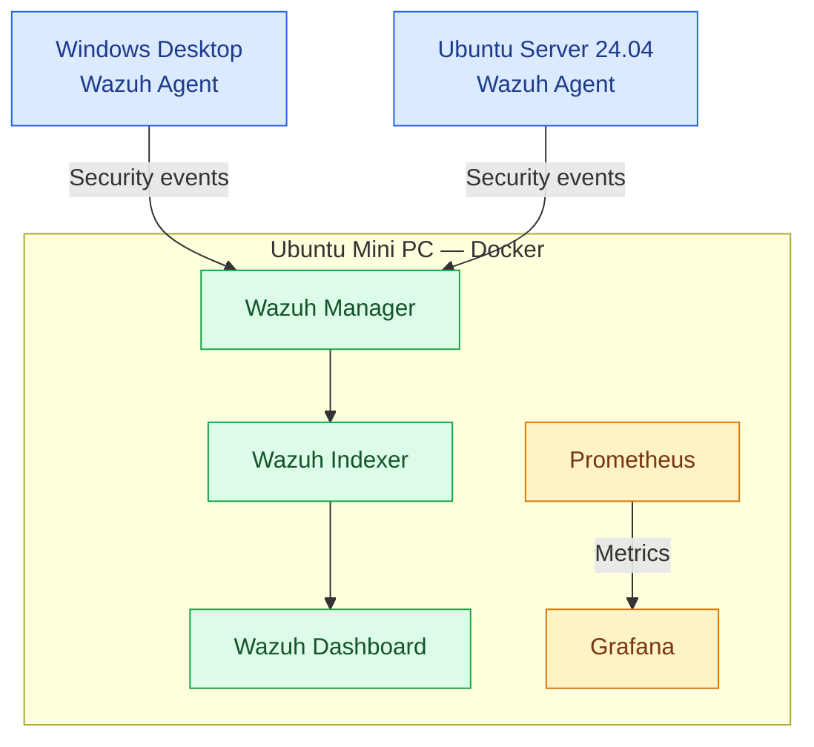

# Cybersecurity Homelab Architecture

## Overview

This document illustrates the logical architecture of my cybersecurity homelab.

The environment consists of a dedicated Ubuntu Server mini PC hosting containerized infrastructure monitoring and security services, with Wazuh agents installed on both Ubuntu and Windows.

## Architecture Diagram

## Infrastructure Components

### Ubuntu Server

The Ubuntu mini PC provides the underlying infrastructure, hosting Docker containers and the local Wazuh agent.

### Wazuh SIEM

Wazuh provides centralized security event collection, analysis, storage, and visualization for Linux and Windows endpoints.

### Prometheus and Grafana

Prometheus provides metrics collection and querying, while Grafana provides infrastructure monitoring visualizations.

## Future Improvements

- Add verified network and service communication details.
- Document active Prometheus scrape targets.
- Expand the architecture as additional security tools are deployed.
