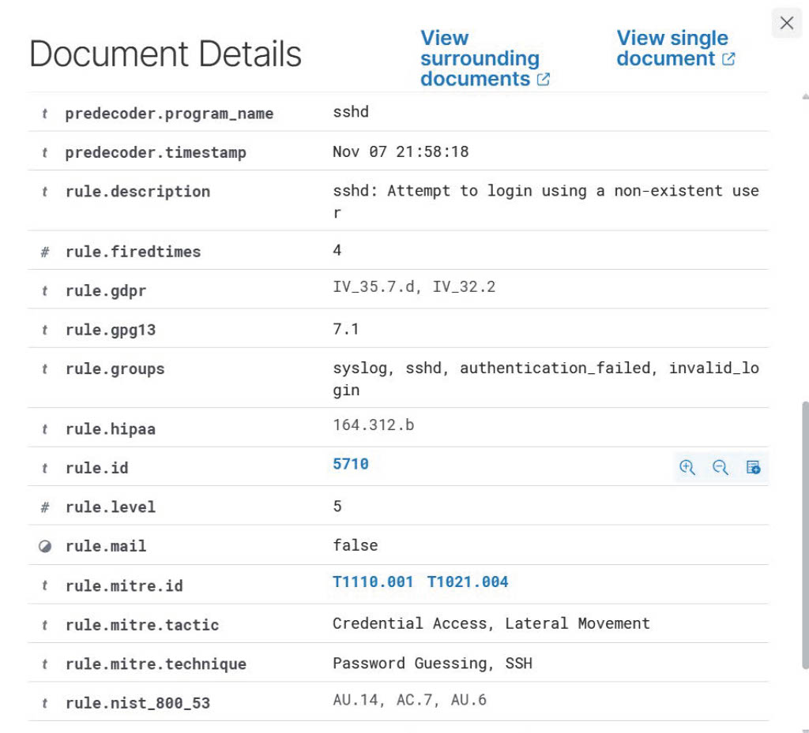

# Incident Lab 02: Linux SSH Authentication Failure

## Incident Overview

**Date:** November 7, 2026  
**Affected Endpoint:** ubuntu-homelab  
**Source IP:** 192.168.4.33  
**Target Service:** SSH (TCP/22)  
**Detection Tool:** Wazuh SIEM  
**Wazuh Rule ID:** 5710  
**Alert Severity:** Level 5  
**Classification:** Authorized security testing

## Incident Description

During a controlled homelab test, SSH authentication attempts were made against a nonexistent Linux user.

The Ubuntu Server recorded failed authentication attempts, and the Wazuh SIEM generated an alert identifying the activity.

## Investigation Findings

1. Reviewed Ubuntu SSH logs using `journalctl`.
2. Identified invalid-user authentication attempts and failed passwords.
3. Located the corresponding alert in Wazuh Threat Hunting.
4. Confirmed Wazuh rule 5710, indicating an attempt to log in using a nonexistent user.
5. Correlated the source IP address `192.168.4.33` between Ubuntu logs and Wazuh.
6. Identified MITRE ATT&CK technique T1110.001 (Password Guessing).

## Security Analysis

The observed authentication failures demonstrate how unauthorized login attempts can be identified through Linux authentication logs and SIEM correlation.

Although Wazuh mapped the alert to password guessing, the observed activity alone does not establish a sustained brute-force attack.

## Conclusion

The activity was part of an authorized homelab test.

The investigation confirmed that the Ubuntu endpoint generated authentication logs and that Wazuh successfully detected the activity.

**Outcome:** Detection validated; no confirmed compromise.

## Recommended Follow-Up

- Monitor repeated authentication failures.
- Investigate unfamiliar source IP addresses.
- Consider SSH key-based authentication.
- Review SSH access restrictions and rate-limiting protections.

## Detection Evidence

The Wazuh SIEM detected failed SSH authentication attempts
against a nonexistent Linux user.

The alert was generated by Wazuh rule 5710 at severity level 5.

### Wazuh SSH Authentication Alert

### Log Correlation

The source IP address `192.168.4.33` was identified in both
the Ubuntu SSH authentication logs and the Wazuh alert.

This confirms that the SIEM successfully collected and
classified the authentication event.
