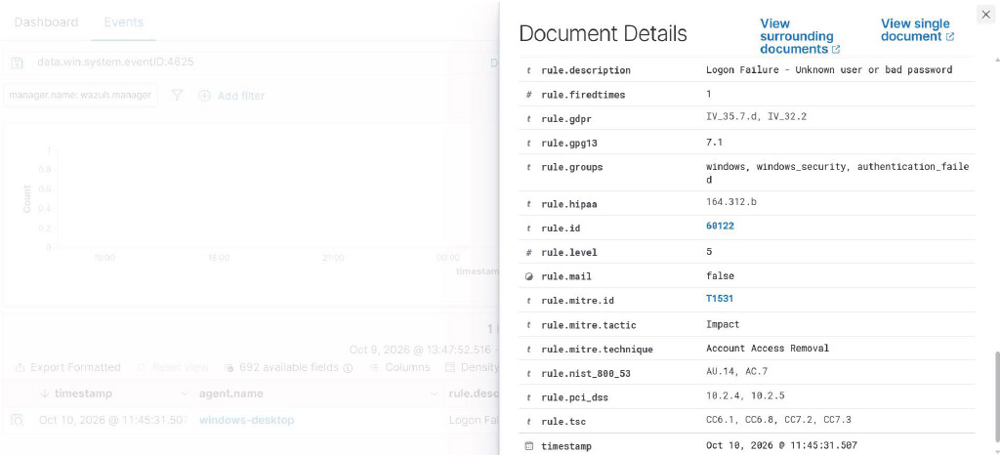

# Lab 01: Windows Failed Login Detection with Wazuh

## Objective

Demonstrate how Wazuh SIEM detects and analyzes failed Windows authentication attempts using Windows Security Event ID 4625.

This lab was performed in my personal cybersecurity homelab using a Windows endpoint connected to a containerized Wazuh deployment.

## Lab Environment

| Component | Configuration |
|---|---|
| SIEM | Wazuh 4.14.8 |
| SIEM Host | Ubuntu Server 24.04 |
| Deployment | Docker Compose |
| Endpoint | Windows desktop |
| Wazuh Agent | windows-desktop |
| Event Source | Windows Security Event Log |

## Step 1: Verify Windows Security Log Collection

Confirmed that the Wazuh Windows agent was configured to monitor the Security event channel.

Relevant configuration:

```xml
<localfile>
  <location>Security</location>
  <log_format>eventchannel</log_format>
</localfile>
```

The existing configuration did not exclude Event ID 4625.

## Step 2: Generate a Controlled Authentication Failure

To test detection, I locked my Windows workstation and intentionally entered an incorrect password once.

After the authentication attempt failed, I signed in normally.

This generated a Windows Security event associated with the failed login.

## Step 3: Verify the Windows Event

Using PowerShell, I queried the Windows Security event log:

```powershell
Get-WinEvent -FilterHashtable @{
    LogName = 'Security'
    Id = 4625
} -MaxEvents 3 -ErrorAction SilentlyContinue |
Select-Object TimeCreated, Id
```

The command confirmed that Windows recorded Event ID 4625.

## Step 4: Locate the Alert in Wazuh

Opened the Wazuh Dashboard and navigated to:

**Threat Hunting → Events**

Filtered the results by:

- Agent: `windows-desktop`
- Event ID: `4625`

Wazuh successfully displayed the failed authentication event.

## Step 5: Analyze the Security Alert

The following information was collected from the Wazuh alert:

| Field | Observed Value | Interpretation |
|---|---|---|
| Windows Event ID | 4625 | Failed authentication |
| Rule Description | Logon Failure - Unknown user or bad password | Authentication failure detected |
| Rule Level | 5 | Low-severity alert |
| Logon Type | 2 | Interactive login |
| Status | 0xC000006D | Authentication failure |
| SubStatus | 0xC0000380 | Additional authentication failure information |
| Authentication Package | Negotiate | Windows authentication negotiation mechanism |
| Agent | windows-desktop | Monitored Windows endpoint |

### Key Findings

**Logon Type 2:** The event was associated with an interactive login attempt rather than a network or Remote Desktop login.

**Status 0xC000006D:** Windows reported an authentication failure.

**Authentication Package Negotiate:** Windows used the Negotiate authentication mechanism. This field alone does not establish which underlying authentication protocol was selected.

**Rule Level 5:** Wazuh classified the event as a low-severity security alert.

## Step 6: Security Assessment

The failed authentication event was generated intentionally as part of a controlled test.

The event was expected and did not independently indicate malicious activity.

In a real security investigation, additional context would be necessary, including:

- Frequency of failed authentication attempts
- Source device and account information
- Timing and patterns of authentication failures
- Related security events

## Results

**Detection successful.**

- Windows recorded the failed authentication event.
- The Wazuh agent collected the security event.
- Wazuh generated a level 5 alert.
- The alert was searchable in the Wazuh Dashboard.
- Authentication metadata was available for investigation.

## Skills Demonstrated

- SIEM monitoring
- Windows Event Log analysis
- Security event investigation
- Authentication failure detection
- Wazuh Threat Hunting
- PowerShell event log queries

## Future Improvements

- Investigate repeated authentication failures in a controlled environment.
- Explore Wazuh authentication correlation rules.
- Create dashboards for Windows authentication activity.
- Document additional security detection scenarios.

## Detection Evidence

The Wazuh SIEM successfully detected a failed authentication
attempt on the Windows endpoint.

### Alert Details

| Field | Value |
|---|---|
| Endpoint | windows-desktop |
| Windows Event ID | 4625 |
| Wazuh Rule ID | 60122 |
| Alert Level | 5 |
| Description | Logon Failure - Unknown user or bad password |
| Detection Date | October 10, 2026 |

### Wazuh Alert Screenshot



### Security Analysis

Windows Event ID 4625 indicates that an account failed
to authenticate successfully.

Wazuh collected the Windows Security event and generated
an alert using rule 60122 at severity level 5.

This event was generated during a controlled authentication
test in the homelab. The alert demonstrates that the
Windows endpoint is successfully forwarding security
events to the Wazuh SIEM for analysis.

A failed login alone does not establish malicious activity.
Repeated failures or unusual authentication patterns
would warrant further investigation.

## Investigation Summary

### Initial Detection
Wazuh generated a level 5 alert after detecting a failed
Windows authentication attempt (Event ID 4625).

### Investigation Findings
- Affected endpoint: windows-desktop
- Detection rule: 60122
- Event category: Authentication failure
- Alert severity: Level 5
- Activity source: Controlled homelab test

### Assessment
The failed authentication event was generated intentionally
to validate the SIEM's detection capabilities.

The alert confirms that Windows Security events are being
collected and processed by the Wazuh infrastructure.

### Conclusion
Classification: Authorized security testing

The observed event was expected during the controlled test.
No evidence from this alert alone indicates a successful
unauthorized login.

### Recommended Follow-Up
Monitor for repeated authentication failures, unexpected
source addresses, and suspicious login patterns.
